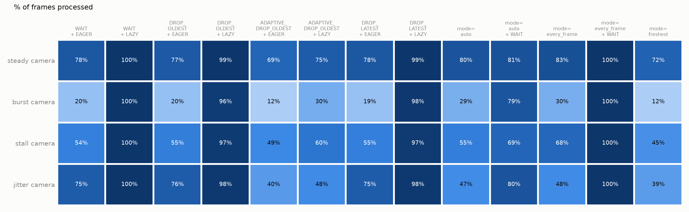
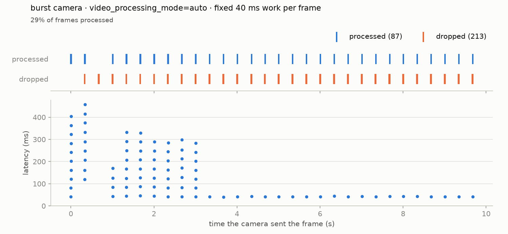
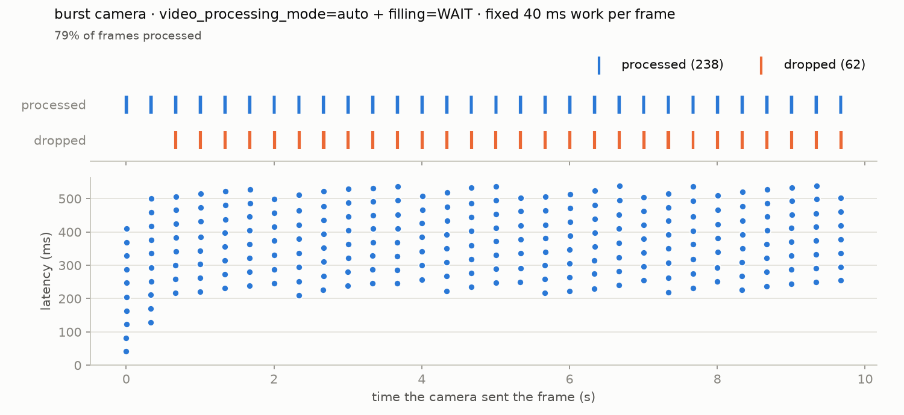
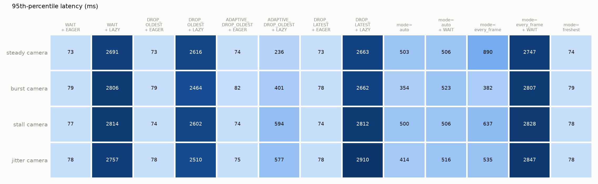
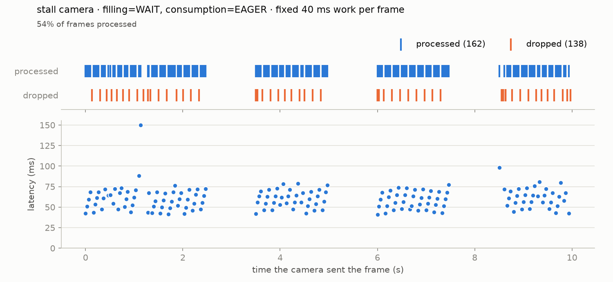

# Uneven cameras vs. Roboflow Inference

What does [Roboflow Inference](https://github.com/roboflow/inference)'s `InferencePipeline` do when a live camera delivers frames **unevenly**: in bursts, after a stall, or with jitter? Which frames get inferred, which are silently dropped, and how stale are the results that come out?

This repo replays Roboflow's public `vehicles.mp4` through `InferencePipeline` from a fake live camera that sends every frame on a precise, deliberately uneven schedule. It logs the fate of every frame across **52 pipeline configurations × 300 frames**, plus real YOLOv8n runs.



## Key results

The stand-in model can keep up with at most **83%** of frames (40 ms of work per frame vs. a camera averaging one frame every 33 ms).

1. **The 1.8 processing modes are held back by the default buffer setting.** On a bursty camera, `video_processing_mode="auto"` processed **29%** of frames, falling to **10%** in the second half of the run. Adding `source_buffer_filling_strategy=WAIT` raised that to **79%**, near the 83% ceiling, while p95 latency stayed at **523 ms**, close to `auto`'s 0.5 s staleness budget. On the jitter camera: 47% → 80%.
2. **`every_frame` does not process every frame from a live source.** It processed **30–83%**, depending on the camera. With `WAIT` filling it processed **100%** on every schedule, at a p95 latency of ~2.8 s. Reproduced on `inference` 1.8.5 and **1.8.6 (latest)** with a [short standalone script](repro/processing_mode_drops.py).
3. **Why:** the processing modes control how frames are *collected* from the source's buffer. But a live source keeps its default filling strategy, `ADAPTIVE_DROP_OLDEST`, which discards frames before the mode ever sees them.
4. **Freshness vs. completeness, measured.** With `EAGER` consumption, p95 latency stayed under 85 ms, but 80–88% of a bursty camera's frames were dropped, along with the entire 30-frame backlog after each stall. `WAIT` + `LAZY` never dropped a frame, but its p95 latency reached 2.7–2.8 s within 10 seconds and was still growing.
5. **With a real model** (YOLOv8n, ~0.7–1.1 s per frame on this laptop), the live default kept latency at **1.0–1.2×** the model's own inference time (median). No backlog built up.

## Why this matters

Real cameras rarely deliver a clean 30 fps. IP cameras bunch frames around encoder pauses (Inference's own source notes 400–500 ms pauses on consumer cameras), networks stall and then flush a backlog, and Wi-Fi adds jitter. Whenever the model is slower than the camera, the pipeline must choose which frames to skip. That choice decides whether you get **complete** results, **fresh** results, or, with the wrong settings, neither.

## How it works

| Piece | File | What it does |
|---|---|---|
| Fake live camera | [`producer.py`](frametiming/producer.py) | Implements Inference's `VideoFrameProducer` with `is_file=False`, so Inference treats it as a live stream. Sends each frame exactly when its schedule says, measured at **≤ 0.16 ms mean / 2.4 ms worst** error. |
| Timing schedules | [`schedules.py`](frametiming/schedules.py) | Four patterns, each averaging 30 fps (see below). |
| Frame ID stamp | [`stamp.py`](frametiming/stamp.py) | Paints each frame's index into its pixels as a 32-bit block barcode (survives JPEG at quality 70) and reads it back inside the pipeline, so the results never depend on Inference's own frame counters. |
| Runner | [`run.py`](frametiming/run.py) | Runs one configuration and logs when every frame was sent and when (if ever) its result was ready. |
| Analysis | [`analyze.py`](frametiming/analyze.py) | Summary metrics, charts, and physical sanity checks on the data. |

**Camera schedules** (all average 30 fps; only the *evenness* differs):

| Schedule | Gaps between frames | Imitates |
|---|---|---|
| steady | 33 ms every time | an ideal camera |
| burst | 10 frames 1 ms apart, then a 324 ms pause | encoder/I-frame bunching |
| stall | normal, but freezes for 1 s three times, then the backlog arrives at once | a network hiccup |
| jitter | 33 ms ± random noise (σ = 15 ms, seeded) | a busy network |

**Workload.** Most runs use a stand-in model that takes exactly **40 ms per frame**, slightly slower than the camera's 33 ms. The pipeline is always a little overloaded, so the best possible result is 33.3 / 40 = **83% of frames**. Because the work is fixed, these results don't depend on hardware. Four more runs use the real `yolov8n-640` model.

**Settings compared.**
- Every `BufferFillingStrategy` (WAIT, DROP_OLDEST, ADAPTIVE_DROP_OLDEST, DROP_LATEST) × `BufferConsumptionStrategy` (EAGER, LAZY).
- The `video_processing_mode` options added in 1.8 (`auto`, `every_frame`, `freshest`).
- `auto` and `every_frame` combined with `WAIT` filling.

**Data checks.** `analyze.check_integrity` runs physical sanity checks on every run, and all 56 pass:
- every frame is accounted for and was actually sent,
- no result arrived sooner than the 40 ms of work it needed,
- no two results finished less than 40 ms apart (there is one worker),
- no result was held up more than 1 s beyond what the work explains.

The last check exists because the laptop went to sleep in the middle of one run, which produced a fake 13-minute "latency". That run (and the one after it) was re-run, and the check now catches this automatically.

## Results

### 1. `auto` and `every_frame` need `WAIT` filling on live sources

% of frames processed (p95 latency in ms). The ceiling is 83%.

| Camera | `auto` | `auto` + `WAIT` | `every_frame` | `every_frame` + `WAIT` |
|---|---|---|---|---|
| burst | 29% (354) | **79%** (523) | 30% (382) | **100%** (2,807) |
| jitter | 47% (414) | **80%** (516) | 48% (535) | **100%** (2,847) |
| stall | 55% (500) | **69%** (506) | 68% (637) | **100%** (2,828) |
| steady | 80% (503) | 81% (506) | 83% (890) | **100%** (2,747) |

With `auto` alone on the burst camera, after about 3 s the pipeline processes only **one frame from each 10-frame burst** and drops the other nine:



With `WAIT` filling, it processes about 8 of every 10, and latency stays bounded by the staleness budget:



The standalone repro ([`repro/processing_mode_drops.py`](repro/processing_mode_drops.py)) needs only `pip install inference`. It shows the same thing in about two minutes, identically on both versions (3 runs per case):

```
inference 1.8.6: 150 frames sent per run, 3 runs each, model capacity ~83% of frames
  video_processing_mode="every_frame"                    processed [87, 88, 86] of 150
  video_processing_mode="every_frame" + filling=WAIT     processed [150, 150, 150] of 150
  video_processing_mode="auto"                           processed [82, 81, 82] of 150
  video_processing_mode="auto" + filling=WAIT            processed [125, 125, 125] of 150
```

**Why it happens.** When no filling strategy is given, a live source defaults to `ADAPTIVE_DROP_OLDEST` (`_set_stream_mode_buffering_strategies` in `streamvision/camera/video_source.py`). The processing modes are implemented in `streamvision/camera/collection_policy.py` and govern only the consumer side. Frames the source buffer has already dropped never reach them.

### 2. Freshness vs. completeness



- **`EAGER` consumption** (any filling strategy) always serves the newest frame. p95 latency stays at 73–82 ms on every camera, but on the burst camera it processes only 12–20% of frames.
- **`WAIT` + `LAZY`** processes every frame, in order. Whenever the model is even slightly too slow, the queue grows for the entire run: p95 latency reaches 2.7–2.8 s after 10 s.
- **`ADAPTIVE_DROP_OLDEST` + `LAZY`** sits in between: 30–75% processed, with p95 latency of 0.24–0.59 s.

### 3. Stalls: the backlog is thrown away

After each 1 s freeze, the stall camera delivers the 30 frames it owed all at once. `EAGER` jumps to the newest and drops the rest. With `WAIT`, `DROP_OLDEST` or `DROP_LATEST` filling, the longest run of consecutive dropped frames is exactly **30**: the whole backlog. (`ADAPTIVE_DROP_OLDEST`: 16.)



### 4. Adaptive dropping changes over a run

Settings that rely on `ADAPTIVE_DROP_OLDEST` behave differently in the first and second half of the same 10 s run, so a short benchmark can mislead in either direction:

| Run | 1st half processed | 2nd half processed |
|---|---|---|
| burst, `auto` | 48% | 10% |
| burst, `every_frame` | 49% | 10% |
| jitter, `auto` | 31% | 64% |
| jitter, live default (`ADAPTIVE_DROP_OLDEST` + `EAGER`) | 27% | 53% |
| burst, `auto` + `WAIT` (for comparison) | 81% | 77% |

### 5. Real model: latency tracks inference time

YOLOv8n (`yolov8n-640`) with the live default settings (`ADAPTIVE_DROP_OLDEST` + `EAGER`). The model takes far longer than the camera's 33 ms, so most frames are skipped by design. The question is whether results go stale:

| Camera | Median time per inference | Median latency | Latency ÷ inference time (median / p95) |
|---|---|---|---|
| steady | 959 ms | 1,060 ms | 1.07 / 1.40 |
| burst | 1,085 ms | 1,401 ms | 1.20 / 1.42 |
| stall | 866 ms | 915 ms | 1.23 / 1.66 |
| jitter | 655 ms | 426 ms | 1.00 / 1.76 |

Latency stays within about one inference time of the frame arriving. Because this laptop's speed varied 2–3× between and within runs, the ratio is the meaningful number, not the milliseconds.

## What I'd tell the Inference team

<!-- Leo: write this section in your own words (see docs/findings.md). -->

## Limitations

- **Simulated workload.** The 40 ms "model" is a sleep. It isolates pipeline behavior from hardware, but real models vary from frame to frame.
- **One machine.** All runs were on a Snapdragon X Elite laptop (ARM64) running x86-64 Python under emulation. Real-model inference is therefore slow (~0.7–1.1 s per frame in the published runs, 0.3–0.4 s in an earlier one) and varied 2–3× between and within runs as the laptop throttled. Treat absolute model latencies as pessimistic, and use the latency ÷ model-time ratio instead.
- **One run per configuration** in the main grid. The standalone repro runs each of its four cases 3× on each of two versions, and the counts vary by at most 4 of 150 frames.
- **Adaptive strategies change over time.** `ADAPTIVE_DROP_OLDEST` (and the modes that keep it) behave differently in the first and second half of a 10 s run, so a single "% processed" depends on run length. Longer runs could differ again.
- **Synthetic schedules.** They imitate real camera behavior; they are not recorded traces from real cameras.
- **The frame stamp** changes a 256×8 px strip (0.9% of a 640×360 frame) in the top-left corner of every frame the model sees.
- **Version.** The main dataset uses `inference==1.8.5`. The `auto` and `every_frame` results were re-checked on 1.8.6 (the latest at the time) with [`repro/processing_mode_drops.py`](repro/processing_mode_drops.py).

## Reproduce

Python 3.11:

```bash
python -m venv .venv && source .venv/bin/activate      # Windows: .venv\Scripts\activate
pip install -r requirements.txt
pytest                                                 # 61 tests, about 1 min
python repro/processing_mode_drops.py                  # ~2-minute standalone repro, needs only `inference`
python -m frametiming.run --grid --only sleep --out results/runs_sleep.csv     # 52 runs, ~15 min
export ROBOFLOW_API_KEY=...                            # Windows: $env:ROBOFLOW_API_KEY = "..."
python -m frametiming.run --grid --only model --out results/runs_model.csv     # 4 YOLOv8n runs
python -m frametiming.analyze results/runs_sleep.csv results/runs_model.csv    # summary, checks, charts
```

`--quick` runs 60 frames per configuration instead of 300. Raw per-frame data is in [`results/runs_sleep.csv`](results/runs_sleep.csv) and [`results/runs_model.csv`](results/runs_model.csv) (one row per frame: send time, processed or not, finish time, latency). Per-run metrics are in [`results/summary.csv`](results/summary.csv). There is a timeline chart for every run in [`results/plots/`](results/plots).

Notes on the API, including where 1.8.x moved things, are in [`docs/api-notes.md`](docs/api-notes.md).
